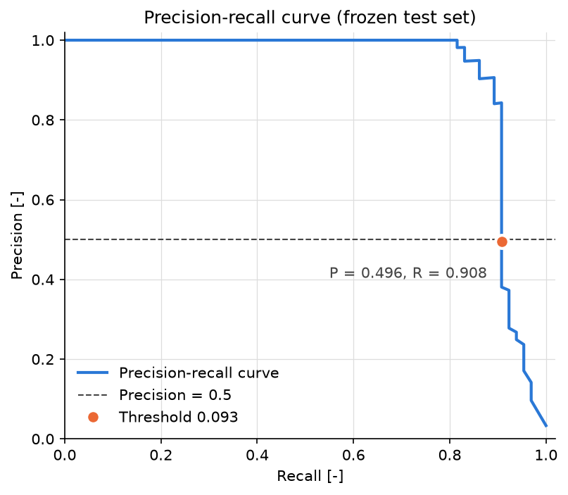
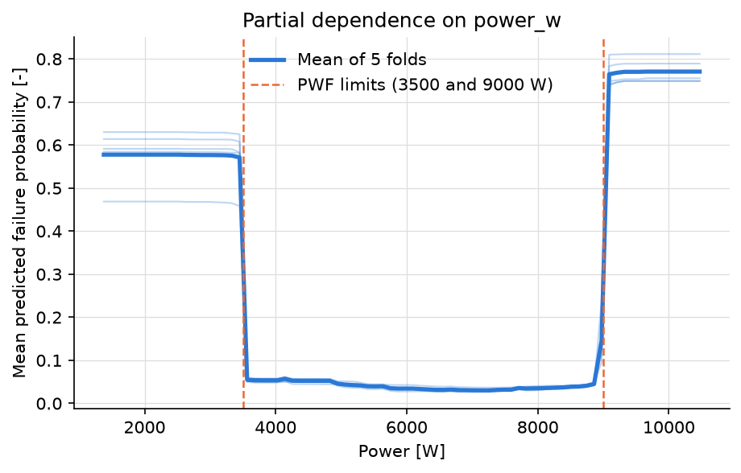
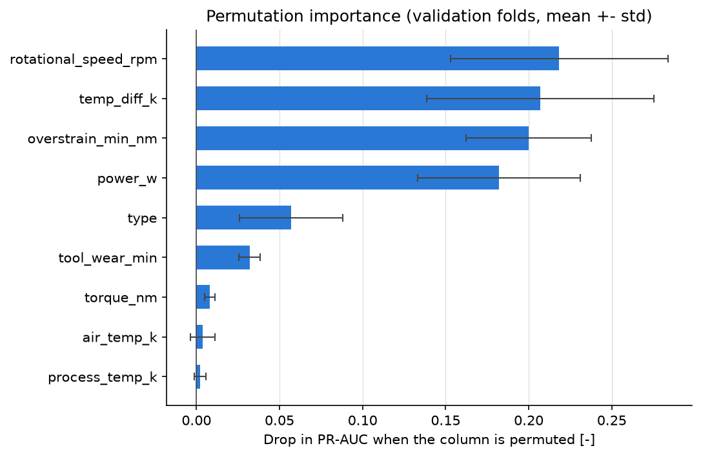
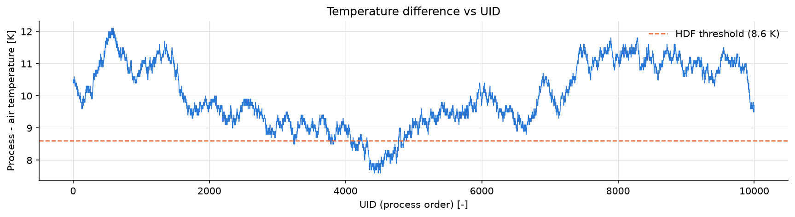

# Predictive maintenance on AI4I 2020

Predict whether a milling process will end in a machine failure, using the AI4I 2020
synthetic dataset (10,000 processes, 3.4 % failures). The data is split by whole tool
cycles so that nearly identical neighbouring processes never end up on both sides of the
split. Logistic regression, random forest and XGBoost are compared with 5-fold grouped
cross-validation using PR-AUC. Three physics features (temperature difference, power and
overstrain) are added to the five sensor values. The selected model is a random forest
with a threshold chosen for maximum recall at 50 % precision. It is evaluated once on a
frozen test set.

## Results

Frozen test set (24 tool cycles, 1,951 processes, 65 failures), threshold 0.093:

| Metric | Cross-validation | Test |
| --- | --- | --- |
| PR-AUC | 0.898 ± 0.042 | **0.917** |
| Precision | 0.507 | **0.496** |
| Recall | 0.883 | **0.908** |
| Detected / missed / false alarms | 242 / 32 / 235 | 59 / 6 / 60 |

The success criterion (recall of at least 75 % with precision of at least 50 %, and
PR-AUC clearly above logistic regression) is met for recall and PR-AUC but missed for
precision by one false alarm (60 false alarms for 59 detected failures). The threshold was
not moved after seeing the test set. See [docs/decisions.md](docs/decisions.md),
section 23.

Key findings:

1. **Physics features matter as much as the model.** They raise random forest PR-AUC from
   0.742 to 0.898 in cross-validation (logistic regression only goes from 0.464 to 0.494).
2. **The deterministic failure modes are fully detected.** HDF, PWF and OSF are detected at
   100 % in both cross-validation and test.
3. **Every missed failure is unpredictable with these inputs.** All misses are tool wear
   failures (TWF, which happen at a random time between 200 and 240 min) or failures with
   no recorded cause.



The model has learned the generator's rules: the predicted risk jumps exactly at the power
limits of 3500 W and 9000 W, and the most important inputs are the ones used by the
failure rules.





## Data

[AI4I 2020 Predictive Maintenance Dataset](https://archive.ics.uci.edu/dataset/601/ai4i+2020+predictive+maintenance+dataset)
(UCI Machine Learning Repository, S. Matzka, 2020). Each row is one process with product
type (L, M, H), air and process temperature [K], rotational speed [rpm], torque [Nm] and
tool wear [min]. The label is machine failure, which is the logical OR of five failure
modes: tool wear (TWF), heat dissipation (HDF), power (PWF), overstrain (OSF) and random
(RNF). The modes are used only to analyse errors, never as inputs.

Rows are a time sequence: tool wear forms a sawtooth, and each tooth (120 in total) is
one tool cycle. The temperature difference drifts over time, and heat dissipation failures
only happen while it is below 8.6 K:



## Method

1. Download the data and rename the columns ([scripts/dataset_import.py](scripts/dataset_import.py),
   [scripts/process.py](scripts/process.py)).
2. Detect tool cycles and add the physics features
   ([notebooks/01_data_tests.ipynb](notebooks/01_data_tests.ipynb)).
3. Hold out 20 % of the tool cycles as a frozen test set with StratifiedGroupKFold
   ([notebooks/02_split_tests.ipynb](notebooks/02_split_tests.ipynb)).
4. Compare 12 configurations with 5-fold grouped cross-validation and PR-AUC
   ([notebooks/03_baseline.ipynb](notebooks/03_baseline.ipynb),
   [notebooks/04_forests.ipynb](notebooks/04_forests.ipynb), [scripts/run_cv.py](scripts/run_cv.py)).
5. Choose the threshold on out-of-fold predictions and analyse errors by failure mode
   ([scripts/interpret.py](scripts/interpret.py)).
6. Evaluate once on the test set, plus two secondary experiments: temporal drift and a
   model that only uses inputs known before the process
   ([scripts/evaluate_test.py](scripts/evaluate_test.py)).

Every decision and its reason is in [docs/decisions.md](docs/decisions.md); a short
technical report is in [docs/report.md](docs/report.md).

## Project structure

```
dataset/     raw and processed data (not tracked, regenerated by the scripts)
docs/        decisions, technical report and figures used in this README
notebooks/   exploration and experiments, numbered in order
results/     metrics (CSV) and figures (not tracked, regenerated by the scripts)
scripts/     end-to-end steps, run in order
src/pm/      reusable package: config, data loading, features, splits, models, evaluation
```

## How to run

Requires Python 3.10 or later. On Windows PowerShell:

```powershell
python -m venv .venv
.\.venv\Scripts\Activate.ps1
pip install -r requirements.txt
pip install -e .

python scripts/dataset_import.py   # download the raw data
python scripts/process.py          # rename columns, tool cycles, physics features
python scripts/run_cv.py           # cross-validation, thresholds, recall by mode
python scripts/interpret.py        # permutation importance, partial dependence, missed failures
python scripts/evaluate_test.py    # final test evaluation and secondary experiments
```

On Linux or macOS, activate the environment with `source .venv/bin/activate`.

## Limitations

- **Synthetic data.** The failures follow simple rules, which is why the deterministic
  modes are detected at 100 %. Real failures are noisier.
- **One sensor value per process.** There is no time series inside a process, and the model
  assumes torque and process temperature are known when the prediction is made. Without
  them PR-AUC falls from 0.90 to 0.40 (section 25).
- **The threshold depends on real costs.** 0.093 maximises recall at 50 % precision, an
  assumption in the absence of costs. If a missed failure cost about 10 false alarms, a
  threshold near 0.3 would be better.
- **Drift over time.** Trained on the first 96 cycles and evaluated on the last 24, PR-AUC
  drops from 0.917 to 0.793 (section 24). A deployed model would need monitoring and
  retraining.
